**Video demostrativo:** [Ver el segundo parcial de Seguridad de Redes en YouTube](https://youtu.be/cIgDrLqfHaw)

# Segundo Parcial — Seguridad de Redes
**Adrian Magallanes · Matrícula 2025-2139**  
Cisco IOS · Active Directory / NPS / RADIUS · DHCP · SSH · Port-security · Zabbix / SNMP · Revisión de hardening

Laboratorio desarrollado en GNS3 y VMware. Reúne la configuración exportada del router **R-2139**, las salidas originales disponibles del parcial, las capturas del monitoreo de R-2139 y SW-2139, y antecedentes de prácticas de AAA y monitoreo.

## Recorrido de la entrega

| Contenido | Acceso |
|---|---|
| Topología y direccionamiento | [Diseño de red](docs/TOPOLOGIA.md) |
| Configuraciones públicas | [Router y switch](configs/README.md) |
| Pruebas y alcance de los resultados | [Matriz de validación](docs/PRUEBAS.md) |
| Capturas y transcripciones | [Evidencias](evidencias/README.md) |
| Análisis estático de hardening | [Informe generado](reportes/informe-cis-R-2139.md) |
| Herramienta y reproducción | [Scripts](scripts/README.md) |
| AD, NPS y RADIUS | [Estado del parcial y preparación](docs/RADIUS.md) |
| Monitoreo SNMP del parcial | [Evidencias de R-2139 y SW-2139](docs/ZABBIX.md) |
| Metodología de auditoría | [Alcance e informe inicial](docs/AUDITORIA.md) |

## Topología del parcial

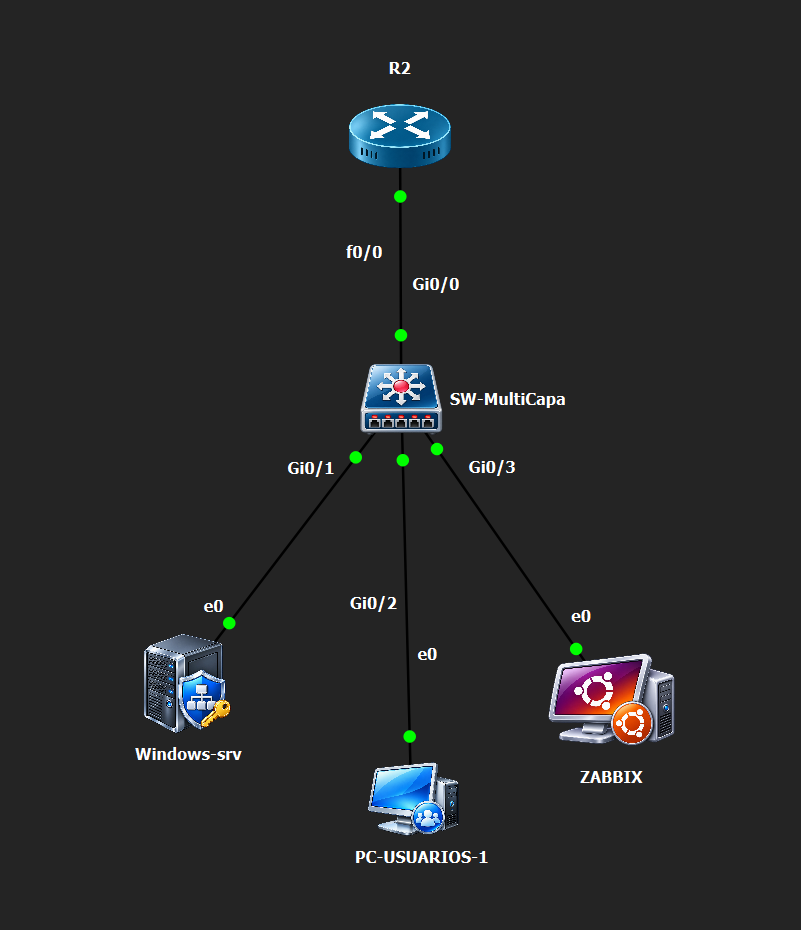

Captura original aportada por el autor. En GNS3, los nodos aparecen como **R2**, **SW-MultiCapa**, **Windows-srv**, **PC-USUARIOS-1** y **ZABBIX**; estas etiquetas visuales se conservan tal como aparecen.

### Diagrama lógico y direccionamiento


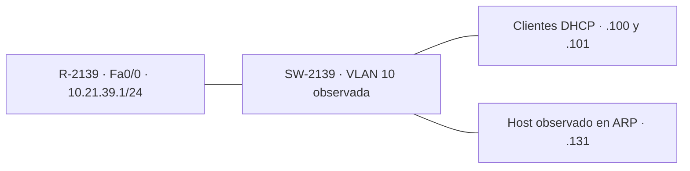

El diagrama representa la LAN lógica; la salida disponible no identifica todos los enlaces físicos ni el papel del host .131. El running-config recibido de SW-2139 confirma Vlan10 con dirección de gestión 10.21.39.2/24.

## Resultados documentados

- Conectividad: R-2139 obtuvo 5/5 respuestas desde 10.21.39.2 y 10.21.39.10. [Transcripción](evidencias/parcial/router-conectividad-dhcp.txt).
- DHCP: concesiones automáticas **10.21.39.100 y 10.21.39.101**, tabla de conflictos vacía.
- Router: SSHv2 habilitado, VTY con autenticación local y acceso exclusivo por SSH; Fa0/0 activa.
- Switch: port-security activo en Gi0/1–Gi0/3, máximo **2 MAC**, acción **shutdown**. La prueba posterior en **Gi0/3** registró **1 violación**, estado **Secure-shutdown / err-disabled** y el evento PSECURE_VIOLATION. [Evidencia de consola](evidencias/parcial/port-security-violacion-Gi0-3.txt).
- Hardening: script ejecutado sobre la copia sanitizada de IOS 12.4; identifica controles presentes y hallazgos, sin conectarse ni modificar el router.
- Zabbix: las nuevas capturas muestran CPU, memoria y tráfico de R-2139, y tráfico y estado de interfaces de SW-2139.
- AD/NPS: la nueva captura confirma IAS en Running, servidor 10.21.39.10/24, grupos RED-NIVEL-0/5/10 y cliente SW-2139 (.2) habilitado. El listado aún no incluye el router actual (.1).
- AAA: SW-2139 tiene RADIUS configurado en SSH; falta acreditar una autenticación actual. El router aún tiene AAA deshabilitado. Los eventos NPS de la práctica anterior se conservan como antecedentes.

La violación de port-security está acreditada mediante la salida real de SW-2139, aportada por el autor tras el ensayo en Gi0/3. Las capturas anteriores con contador cero se conservan como estado previo. La recuperación también está acreditada: Gi0/3 regresó a Secure-up / connected, con una MAC aprendida y conservando el contador de 1 violación.

## Estructura

```text
configs/        Running-configs sanitizados de R-2139 y SW-2139
docs/           Topología, pruebas y metodología
evidencias/     Material original del parcial
scripts/        Auditor y comandos de consulta
reportes/       Resultado reproducible de la revisión
antecedentes/   Prácticas AAA y Zabbix con su topología original
```

## Protección de datos

Se sustituyeron hashes de credenciales y comunidad SNMP por marcadores. Los secretos RADIUS de los antecedentes también están ocultos. Las copias públicas son documentación y no deben pegarse directamente en los equipos. No se incluyen imágenes IOS, discos virtuales ni respaldos privados.

El análisis usa controles seleccionados de hardening relacionados con [CIS Cisco Benchmarks](https://www.cisecurity.org/benchmark/cisco). Es una revisión adaptada al laboratorio, no una certificación CIS ni una evaluación completa de un benchmark.

## Evidencias incrustadas

### DHCP, interfaces y SSH del router

La [transcripción original](evidencias/parcial/router-verificacion.txt) conserva las salidas disponibles. No se recuperó una captura de estos comandos del parcial.

### Port-security del parcial

**Antes de la prueba:** captura original con contador cero.


**Después de la prueba en Gi0/3:** extracto de la transcripción original (no es una captura de pantalla).

```text
Port Status                : Secure-shutdown
Maximum MAC Addresses      : 2
Last Source Address:Vlan   : 0221.3900.0002:10
Security Violation Count   : 1
```

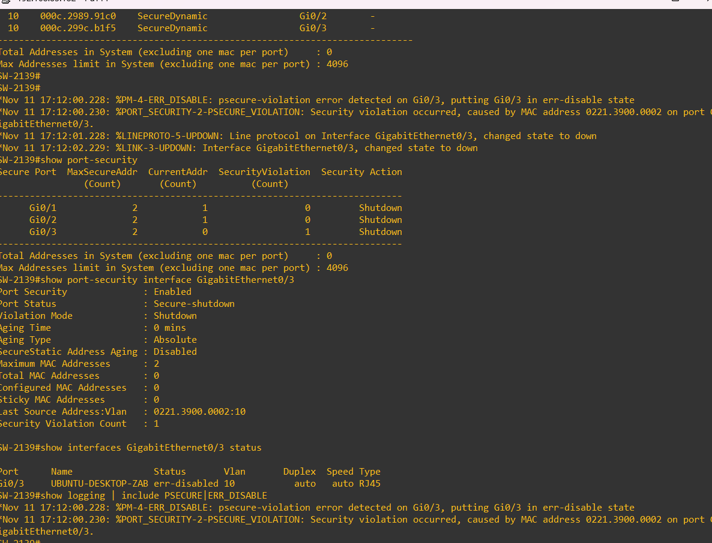

**Recuperación del puerto:**

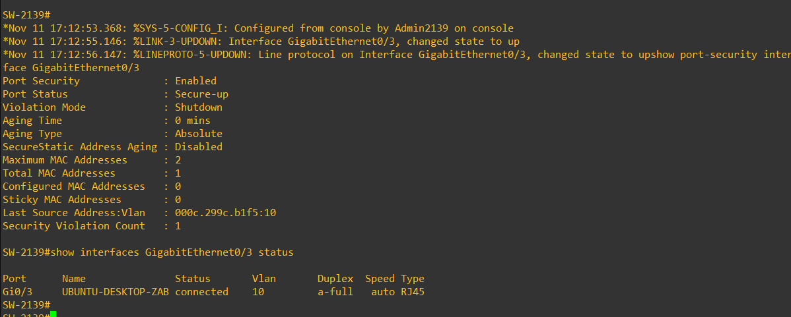

[Salida completa y registros de violación](evidencias/parcial/port-security-violacion-Gi0-3.txt) · [Salida de recuperación](evidencias/parcial/port-security-recuperacion-Gi0-3.txt) · [Procedimiento y recuperación](docs/PRUEBA-PORT-SECURITY.md)

### Active Directory y NPS — estado actual del parcial

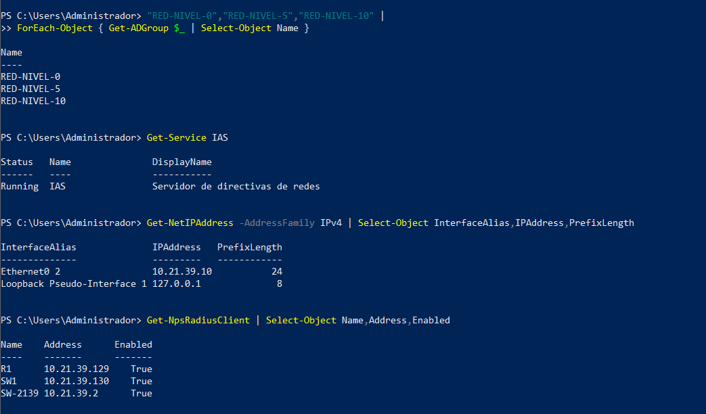

IAS está activo en 10.21.39.10/24 y SW-2139 (.2) está registrado. Falta agregar R-2139 (.1) y comprobar autenticación. Las nuevas capturas también muestran a usuario-n5 en RED-NIVEL-5 y las políticas LAB2139-Nivel10/5/0 habilitadas con shell:priv-lvl 10/5/0; falta verificar cuál se aplica durante una autenticación. [Diagnóstico y siguientes pasos](docs/RADIUS.md).

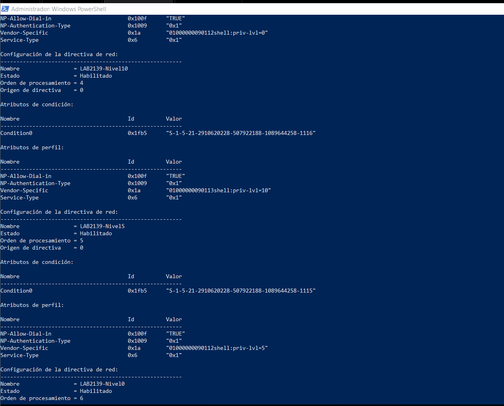

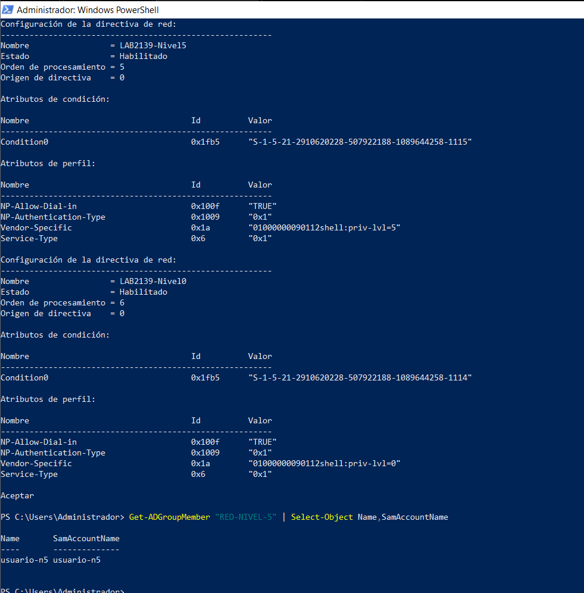

### Active Directory y NPS — antecedente /29


### Sesión SSH — antecedente /29


### Zabbix y SNMP — R-2139 y SW-2139

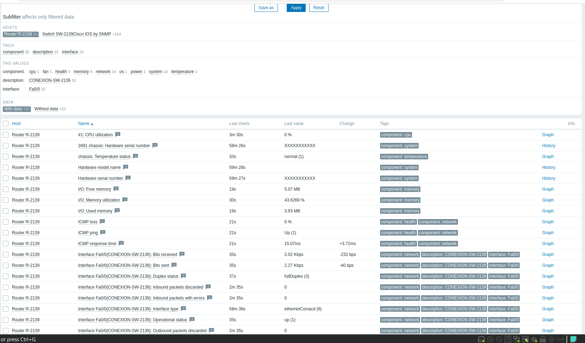

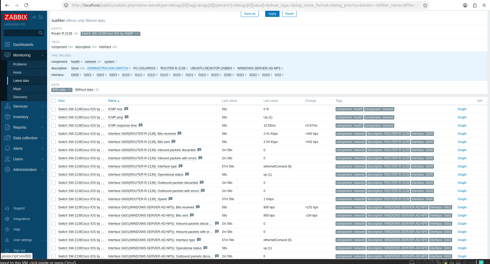

Las capturas muestran los nombres de los equipos y métricas recibidas por Zabbix. No muestran las IP de las interfaces SNMP, la comunidad ni un ensayo de bloqueo por ACL. [Detalle de resultados](docs/ZABBIX.md).

### Zabbix — antecedente A3

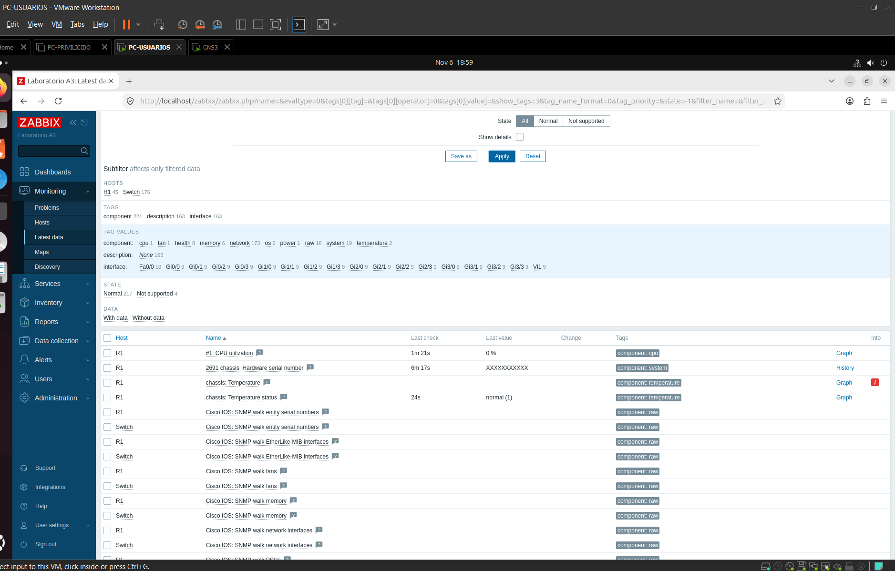

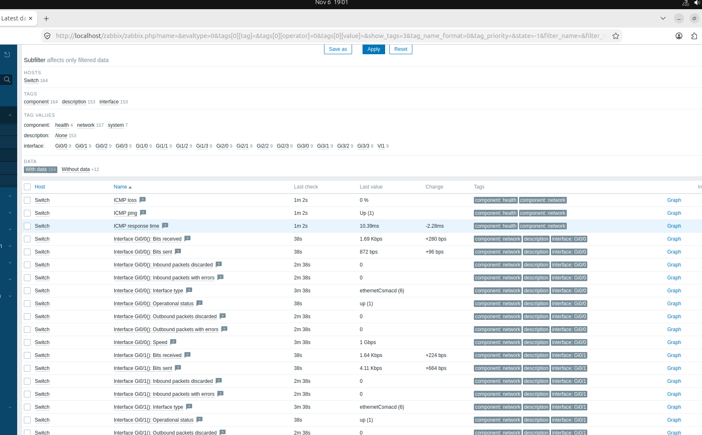
