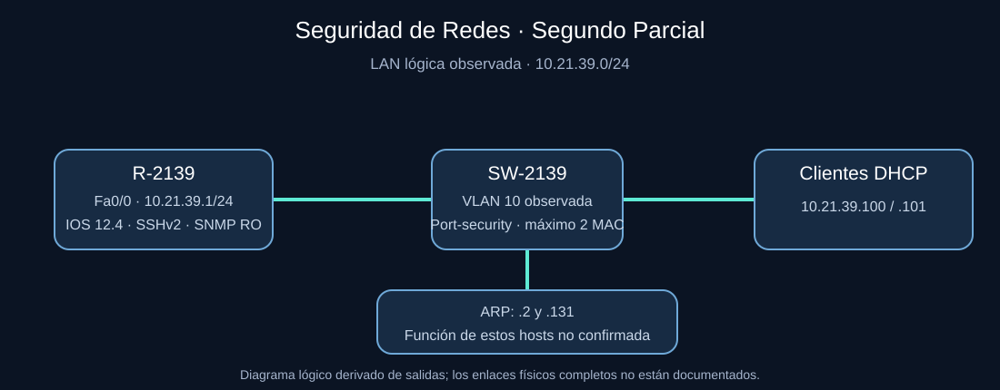
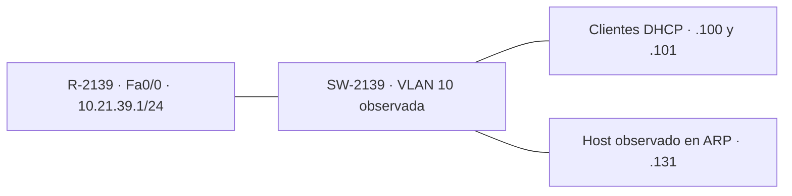
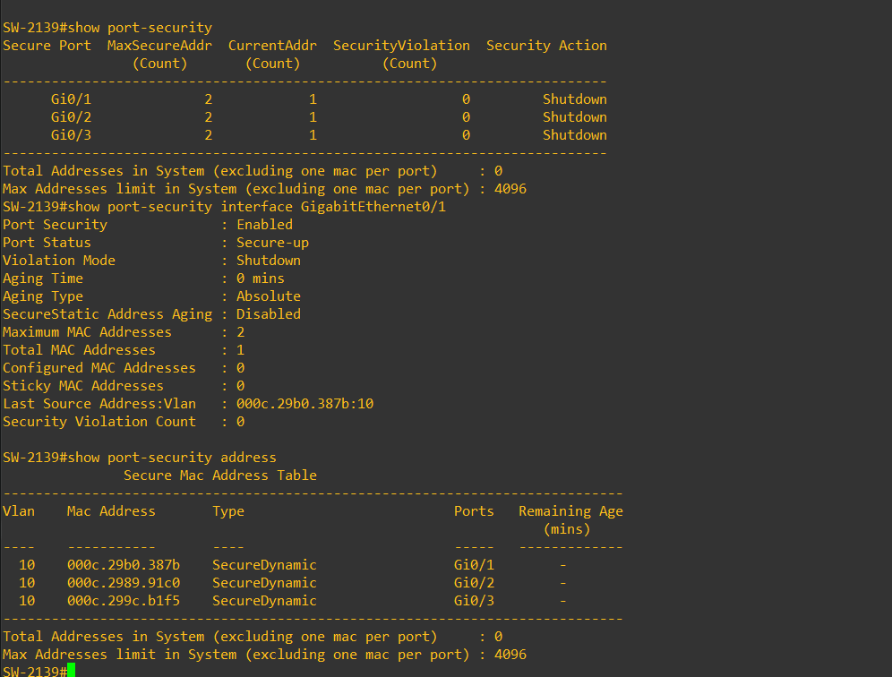
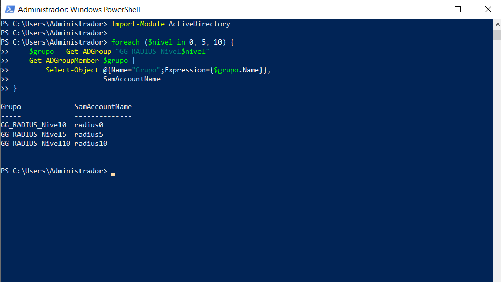
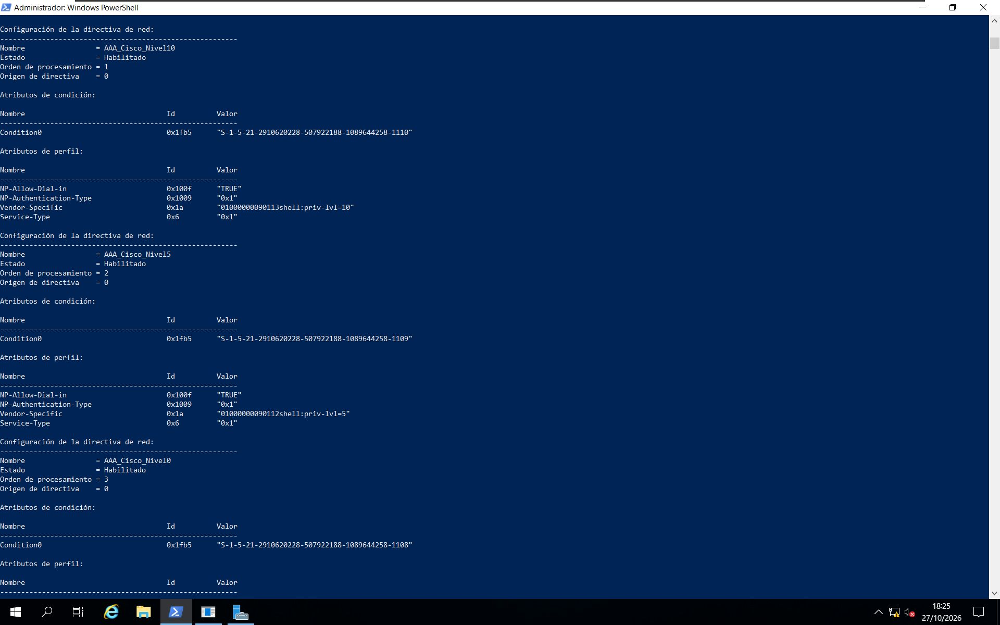
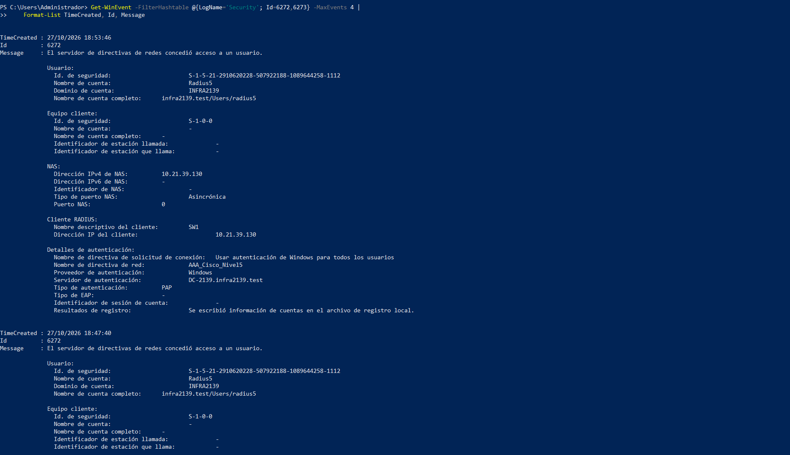
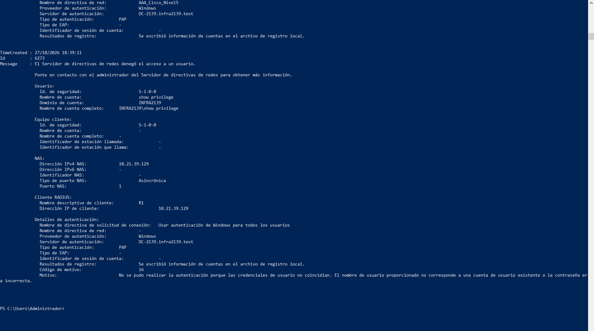
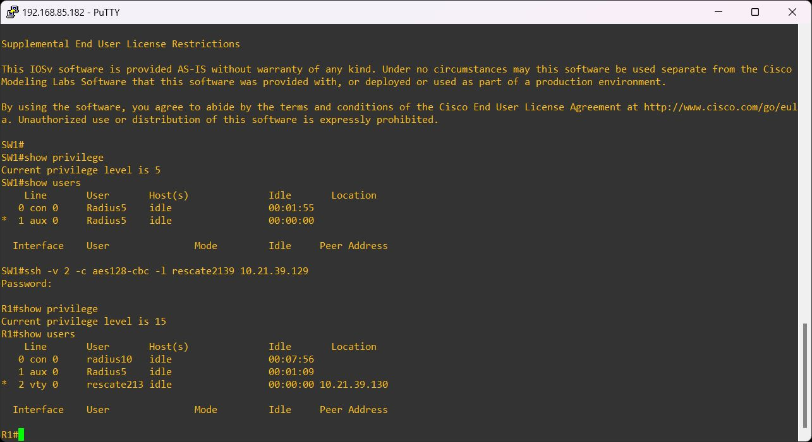

**Video demostrativo:** [Ver el segundo parcial de Seguridad de Redes en YouTube](https://youtu.be/cIgDrLqfHaw)

# Segundo Parcial — Seguridad de Redes
**Adrian Magallanes · Matrícula 2025-2139**  
Cisco IOS · Active Directory / NPS / RADIUS · DHCP · SSH · Port-security · Zabbix / SNMP · Revisión de hardening

Laboratorio desarrollado en GNS3 y VMware. Reúne la configuración exportada del router **R-2139**, las salidas originales disponibles del parcial y antecedentes de prácticas de AAA y monitoreo.

## Recorrido de la entrega

| Contenido | Acceso |
|---|---|
| Topología y direccionamiento | [Diseño de red](docs/TOPOLOGIA.md) |
| Configuraciones públicas | [Router y switch](configs/README.md) |
| Pruebas y alcance de los resultados | [Matriz de validación](docs/PRUEBAS.md) |
| Capturas y transcripciones | [Evidencias](evidencias/README.md) |
| Análisis estático de hardening | [Informe generado](reportes/informe-cis-R-2139.md) |
| Herramienta y reproducción | [Scripts](scripts/README.md) |
| AD, NPS y RADIUS | [Antecedente AAA](antecedentes/AAA/README.md) |
| Monitoreo SNMP | [Antecedente Zabbix](antecedentes/Zabbix/README.md) |

## Topología del parcial


Captura original aportada por el autor. En GNS3, los nodos aparecen como **R2**, **SW-MultiCapa**, **Windows-srv**, **PC-USUARIOS-1** y **ZABBIX**; estas etiquetas visuales se conservan tal como aparecen.

### Diagrama lógico y direccionamiento





El diagrama representa la LAN lógica; la salida disponible no identifica todos los enlaces físicos ni el papel del host .131. La dirección .2 también aparece en ARP, sin identificación suficiente para asignarla como gestión del switch.

## Resultados documentados

- DHCP: concesiones automáticas **10.21.39.100 y 10.21.39.101**, tabla de conflictos vacía.
- Router: SSHv2 habilitado, VTY con autenticación local y acceso exclusivo por SSH; Fa0/0 activa.
- Switch: port-security activo en Gi0/1–Gi0/3, máximo **2 MAC**, acción **shutdown**. La captura conservada muestra contador de violaciones **0**.
- Hardening: script ejecutado sobre la copia sanitizada de IOS 12.4; identifica controles presentes y hallazgos, sin conectarse ni modificar el router.
- AAA y Zabbix: evidencias originales de prácticas anteriores, identificadas expresamente por su procedencia.

La prueba de violación de port-security fue reportada como realizada por el autor en esta conversación; no se dispone de una evidencia posterior que permita verificarla. No se presenta el contador cero como demostración de una violación.

## Estructura

```text
configs/        Configuración sanitizada y fragmento observado del switch
docs/           Topología, pruebas y metodología
evidencias/     Material original del parcial
scripts/        Auditor y comandos de consulta
reportes/       Resultado reproducible de la revisión
antecedentes/   Prácticas AAA y Zabbix con su topología original
```

## Protección de datos

Se sustituyeron hashes de credenciales y comunidad SNMP por marcadores. Los secretos RADIUS de los antecedentes también están ocultos. Las copias públicas son documentación y no deben pegarse directamente en los equipos. No se incluyen imágenes IOS, discos virtuales ni respaldos privados.

El análisis usa controles seleccionados de hardening relacionados con [CIS Cisco Benchmarks](https://www.cisecurity.org/benchmark/cisco). Es una revisión adaptada al laboratorio, no una certificación CIS ni una evaluación completa de un benchmark.

## Evidencias incrustadas

### DHCP, interfaces y SSH del router

La [transcripción original](evidencias/parcial/router-verificacion.txt) conserva las salidas disponibles. No se recuperó una captura de estos comandos del parcial.

### Port-security del parcial



### Active Directory y NPS — antecedente /29









### Sesión SSH — antecedente /29



### Zabbix y SNMP — antecedente A3


