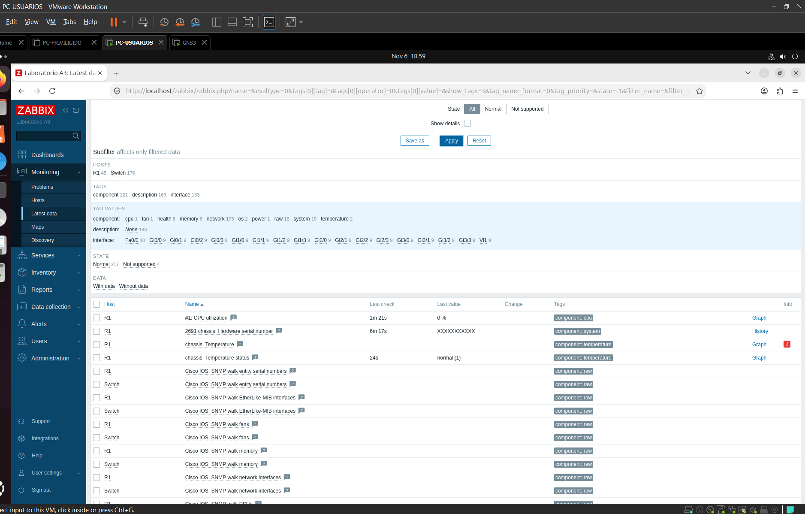
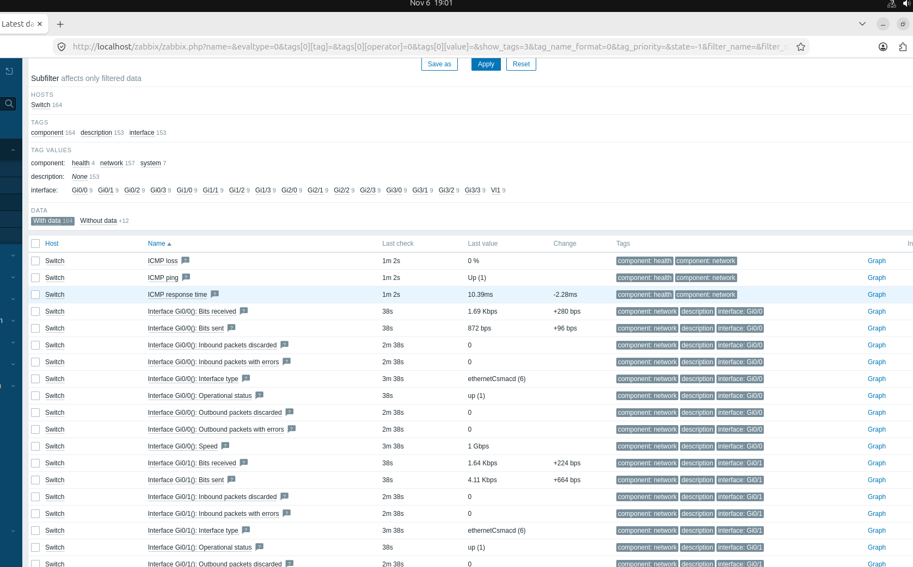

# Antecedente: monitoreo Zabbix y SNMP

Capturas originales de la práctica A3, con R1 .129, Switch .130 y Ubuntu .131 en /29. No se presentan como capturas actuales de R-2139/SW-2139.

El router muestra valores recientes de CPU y estado de temperatura; también existen ítems sin dato o no soportados.

El switch muestra interfaz Gi0/0 up, tráfico y métricas ICMP. El ítem Speed muestra 1 Gbps: no se extrapola como velocidad física del enlace del parcial.

En el R-2139 del parcial, la configuración permite SNMP RO mediante ACL 20 para toda la LAN /24. Esto acredita la configuración del agente, pero no reemplaza una captura de sondeo o de datos recientes del parcial.
