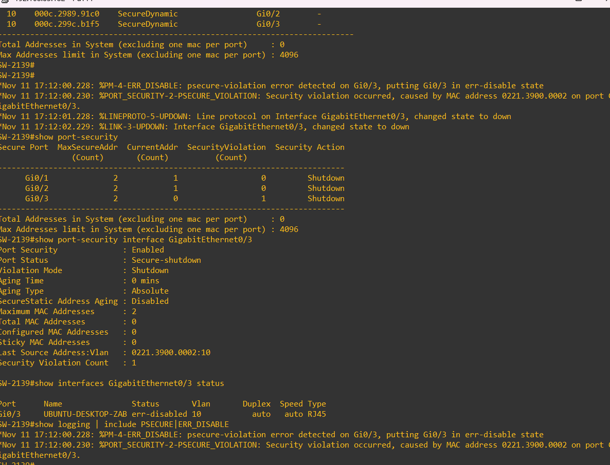
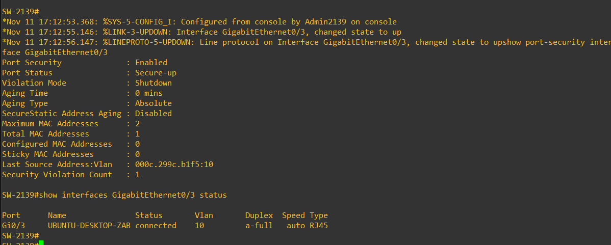

# Prueba real de violación de port-security en Gi0/3

**Estado: violación acreditada.** La salida de consola posterior al ensayo fue aportada por el autor y se conserva como [transcripción original](../evidencias/parcial/port-security-violacion-Gi0-3.txt). La recuperación también está acreditada mediante [captura](../imagenes/parcial/port-security-recuperacion-Gi0-3.png) y [transcripción](../evidencias/parcial/port-security-recuperacion-Gi0-3.txt).

## Puerto e interfaz identificados

Las consultas previas de SW-2139 localizaron la MAC 000c.299c.b1f5 en Gi0/3, VLAN 10, como SecureDynamic en la tabla de port-security. Linux mostró esa MAC en ens33. El puerto conserva la descripción UBUNTU-DESKTOP-ZABBIX.

La tabla general MAC mostró STATIC; la tabla específica de port-security mostró SecureDynamic. Se conserva esa diferencia sin afirmar que se configuró una MAC estática manual.

## Método del ensayo

Se mantuvo el máximo de **2 MAC** y la acción **shutdown**. Desde Linux/ens33 se enviaron tres tramas ARP de prueba con MAC locales distintas (0221.3900.0001, 0221.3900.0002 y 0221.3900.0003), mediante el bloque Python facilitado durante la práctica. El generador no cambia la IP ni la MAC permanente de la interfaz.

Ya existía una MAC aprendida. El evento identifica 0221.3900.0002 como origen causante de la violación; no se afirma que las tres tramas hayan atravesado el puerto tras su bloqueo.

No se utilizó el ensayo alternativo propuesto anteriormente con VPCS y Gi0/2.

## Resultado observado

| Control | Resultado real |
|---|---|
| Puerto / VLAN | Gi0/3 / 10 |
| Máximo de MAC | 2 |
| Modo de violación | Shutdown |
| Contador de violaciones | 1 |
| Estado port-security | Secure-shutdown |
| Estado de interfaz | err-disabled |
| MAC causante | 0221.3900.0002 |
| Registros | PM-4-ERR_DISABLE y PORT_SECURITY-2-PSECURE_VIOLATION |
| Reloj del switch en el evento | Nov 11 17:12:00; marca del dispositivo, sin verificar sincronización |

Gi0/1 y Gi0/2 siguieron mostrando cero violaciones en la consulta posterior. Las salidas anteriores con contador cero se conservan como estado previo, no como resultado del ensayo.

## Consultas de evidencia ejecutadas

```text
show port-security
show port-security interface GigabitEthernet0/3
show interfaces GigabitEthernet0/3 status
show logging | include PSECURE|ERR_DISABLE
```

## Recuperación acreditada

Después de terminar el generador y guardar las consultas anteriores, ejecutar desde la consola GNS3 de SW-2139:

```text
configure terminal
interface GigabitEthernet0/3
shutdown
no shutdown
end
show port-security interface GigabitEthernet0/3
show interfaces GigabitEthernet0/3 status
```

La salida posterior muestra Gi0/3 en **Secure-up / connected**, una MAC aprendida (000c.299c.b1f5), máximo 2 y contador de violaciones 1. Los registros muestran enlace y protocolo de línea nuevamente up. El contador conserva el incidente y no indica una nueva violación activa.





La transcripción separa en líneas el mensaje de subida del enlace y el comando que quedó pegado a continuación en la consola; los valores se conservan. No se aportó todavía un ping posterior desde Linux: la recuperación acreditada aquí corresponde al puerto del switch.

Referencia: [Cisco: port-security y recuperación manual](https://www.cisco.com/c/en/us/support/docs/switches/catalyst-3750-series-switches/72846-layer2-secftrs-catl3fixed.html).
