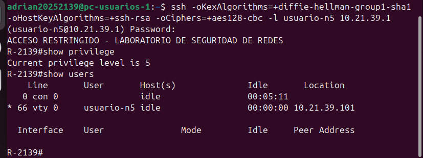
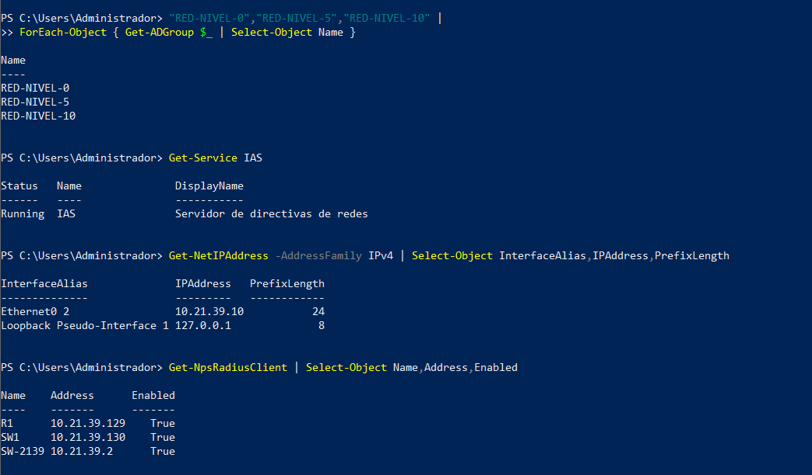
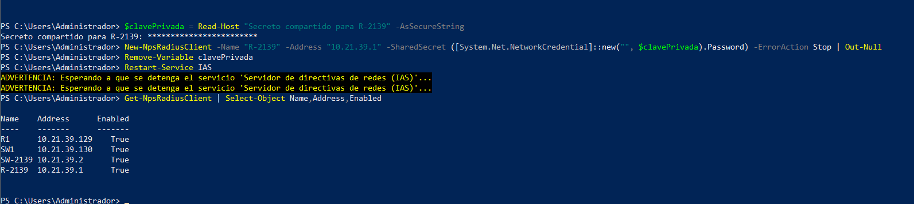
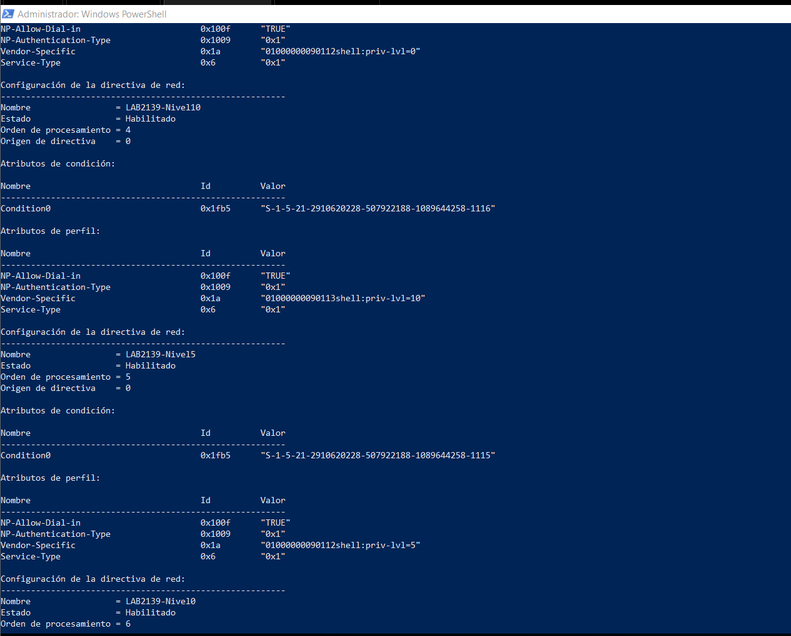
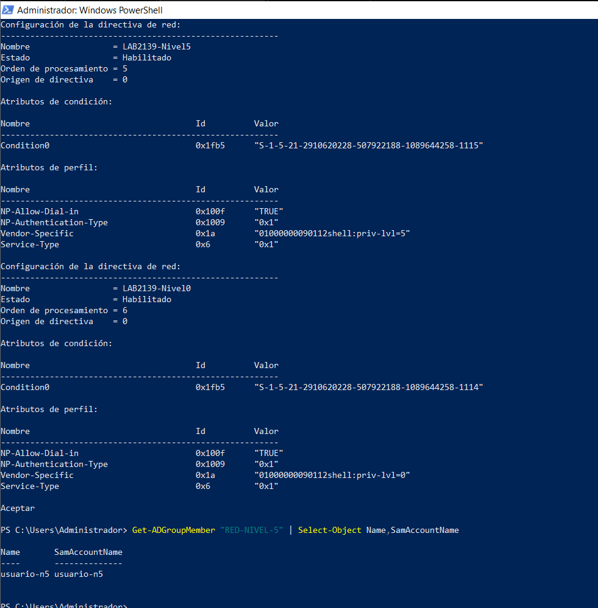
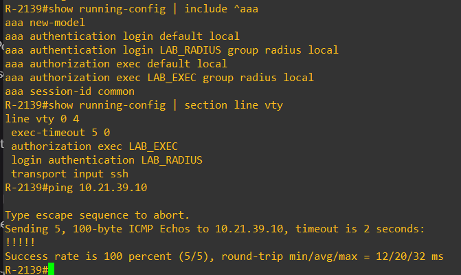
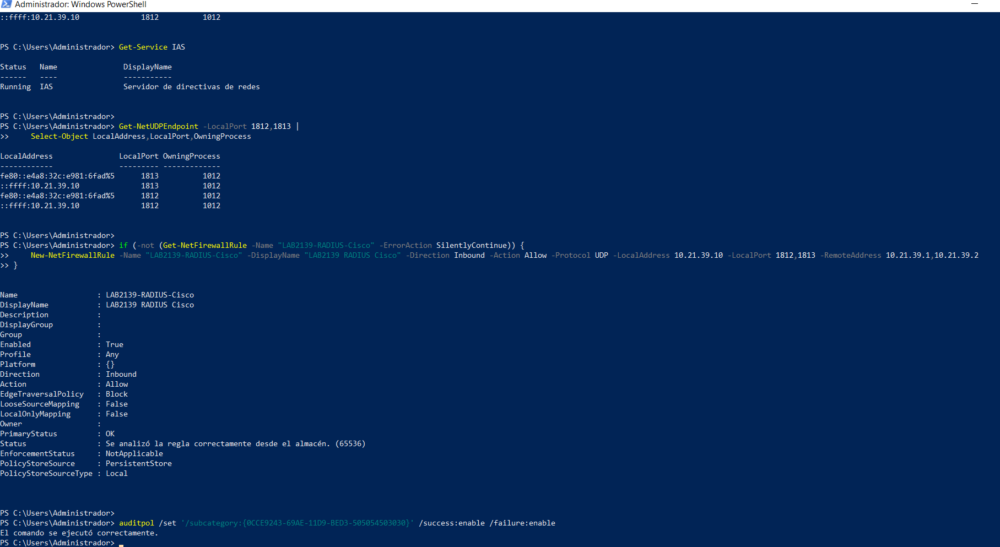

# Active Directory, NPS y RADIUS del parcial

## Resultado actual

**R-2139: SSH aceptado y privilegio 5 verificados.** La captura de la sesión y el evento NPS 6272 aportados por el autor corresponden al entorno /24 del parcial.

| Dato | Evidencia actual |
|---|---|
| Usuario AD | usuario-n5, miembro de RED-NIVEL-5 |
| Cliente SSH | PC-USUARIOS-1, origen 10.21.39.101 |
| Equipo de destino / NAS | R-2139, 10.21.39.1 |
| Sesión IOS | VTY 0, puerto NAS 66 |
| Privilegio observado | 5 |
| Evento NPS | 6272, acceso concedido |
| Política aplicada | LAB2139-Nivel5 |
| Servidor AD/NPS | DC-2139.infra2139.test, 10.21.39.10 |
| Tipo de autenticación registrado | PAP |
| Hora del evento | 11/11/2026 19:23:18, reloj del servidor; zona no verificada |
| Guardado en router | copy running-config startup-config, resultado [OK] |

Fuentes: [evento NPS transcrito](../evidencias/parcial/NPS-6272-R-2139-usuario-n5.txt), [guardado](../evidencias/parcial/R-2139-guardado-configuracion.txt) y [running-config final sanitizado](../configs/R-2139-running-config.sanitized.cfg).

## Preparación de NPS

R-2139 .1 y SW-2139 .2 están registrados. Los clientes R1 .129 y SW1 .130 pertenecen al direccionamiento anterior. Los secretos compartidos se introdujeron localmente y no se publican.

| Política habilitada | Orden observado | Atributo |
|---|---|---|
| LAB2139-Nivel10 | 4 | shell:priv-lvl=10 |
| LAB2139-Nivel5 | 5 | shell:priv-lvl=5 |
| LAB2139-Nivel0 | 6 | shell:priv-lvl=0 |

Las [políticas AAA_Cisco anteriores](../imagenes/parcial/NPS-politicas-AAA-anteriores.png) siguen presentes en órdenes 1–3. El evento recibido determina que esta sesión usó LAB2139-Nivel5. No se afirma que los niveles 0 y 10 hayan sido probados en el entorno actual.

## Configuración de AAA del router

El router usa autenticación y autorización local por defecto; las VTY aplican LAB_RADIUS y LAB_EXEC con RADIUS y respaldo local. El origen RADIUS es FastEthernet0/0 (.1), destino .10, UDP 1812/1813. El respaldo local se usa ante falta de respuesta del servidor; un rechazo explícito de NPS no activa ese respaldo.

La consola mantiene su acceso administrativo. El [bloque preparado durante la implementación](../scripts/R-2139-radius-propuesto.cli) contiene un marcador de secreto; la fuente definitiva del estado aplicado es el running-config exportado, no ese ejemplo.

## Incidencias y resolución observadas

1. Linux rechazó inicialmente el intercambio de claves group1, la clave de host ssh-rsa y los cifrados CBC del IOS antiguo.
2. Se habilitó compatibilidad únicamente en la invocación SSH del laboratorio:
   `ssh -oKexAlgorithms=+diffie-hellman-group1-sha1 -oHostKeyAlgorithms=+ssh-rsa -oCiphers=+aes128-cbc -l usuario-n5 10.21.39.1`.
3. RADIUS acumuló 12 tiempos de espera sin respuestas durante el diagnóstico.
4. La cuenta AD fue comprobada habilitada, sin bloqueo ni contraseña vencida. Se restableció su contraseña para el ensayo; el valor no se publica.
5. Se verificó IAS Running y escucha UDP; se creó la regla LAB2139-RADIUS-Cisco para .10, puertos 1812/1813, con origen limitado a .1/.2. También se habilitó auditoría NPS de éxitos y fallos.
6. El ensayo posterior ingresó por SSH con privilegio 5 y generó el evento 6272. Esta secuencia no constituye una prueba aislada de que el firewall fuera la única causa.

Los algoritmos SSH y PAP son limitaciones del entorno de laboratorio; no se presentan como protección moderna de producción. Referencia: [OpenSSH: compatibilidad con algoritmos antiguos](https://www.openssh.org/legacy.html).

## Pendientes

- Probar SSH/RADIUS en SW-2139 .2 y conservar su evento NPS actual.
- Si la rúbrica exige demostrar cada nivel, aportar sesiones de niveles 0 y 10 de este entorno.
- Añadir una captura del evento 6272 si se requiere evidencia visual del registro; actualmente se conserva su transcripción real.

Los [antecedentes AAA](../antecedentes/AAA/README.md) permanecen separados de estas pruebas.
