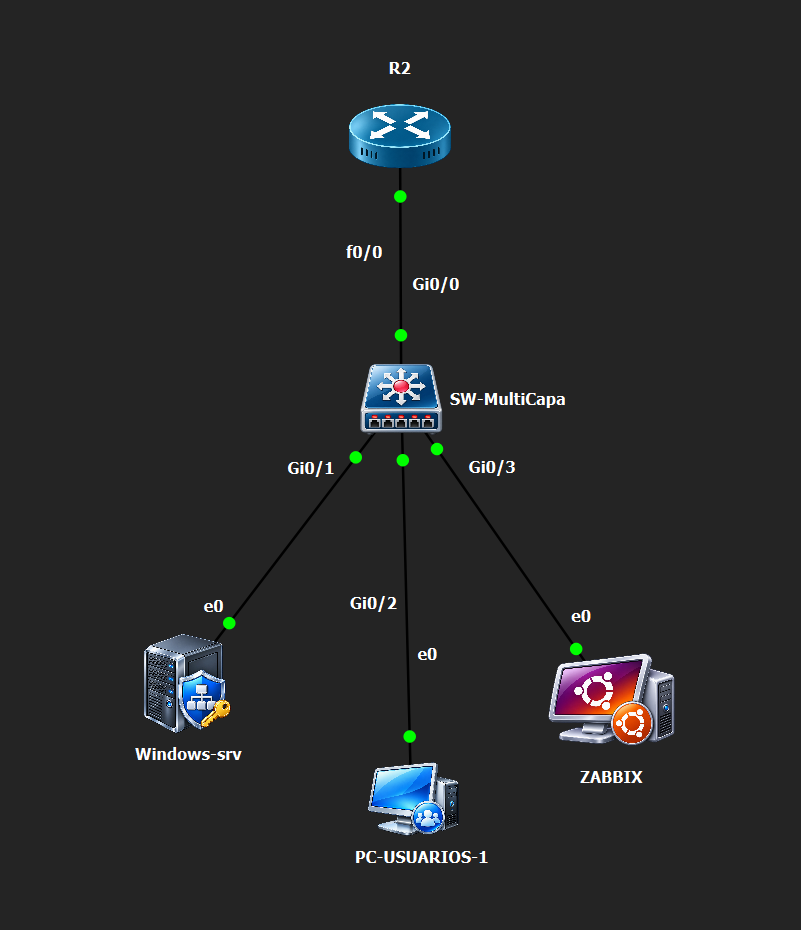

# Diseño y direccionamiento

## Topología en GNS3

| Enlace mostrado | Interfaces |
|---|---|
| R2 — SW-MultiCapa | f0/0 — Gi0/0 |
| SW-MultiCapa — Windows-srv | Gi0/1 — e0 |
| SW-MultiCapa — PC-USUARIOS-1 | Gi0/2 — e0 |
| SW-MultiCapa — ZABBIX | Gi0/3 — e0 |

Los nombres de esta captura son las etiquetas de los nodos GNS3. Se conservan sin sustituirlas por los hostnames IOS de los archivos de configuración. La imagen muestra los enlaces, pero no asigna direcciones IP a los hosts.

## Parcial: red 10.21.39.0/24

| Elemento | Dato sustentado |
|---|---|
| R-2139 | IOS 12.4; Fa0/0 10.21.39.1/24, up/up |
| Fa0/1 del router | Sin dirección, administrativamente apagada |
| DHCP LAN-2139 | Red /24, gateway .1, DNS .10, dominio lab2139.local |
| Exclusiones DHCP | .1–.99 y .131 |
| Clientes con concesión | .100 y .101 |
| Gestión SW-2139 | Vlan10 10.21.39.2/24, gateway 10.21.39.1; confirmado por running-config |
| Otro vecino ARP | .131; función no confirmada |
| SW-2139 | Gi0/0 hacia router; Gi0/1 Windows AD/NPS; Gi0/2 PC; Gi0/3 Ubuntu/Zabbix; puertos access en VLAN 10 |
| Servidor NPS actual | 10.21.39.10/24, interfaz Ethernet0 2; IAS Running confirmado por captura |
| Destino RADIUS del switch | NPS-2139, 10.21.39.10, UDP 1812/1813; autenticación del router confirmada por evento NPS 6272; prueba del switch pendiente |

El pool DHCP anuncia DNS .10; no se dispone de una prueba de resolución que confirme ese servicio. La fecha de vencimiento de concesiones mostrada por IOS pertenece a 2002: documenta el reloj del equipo, no la fecha de ejecución del parcial.

## Diferencias frente a antecedentes

La práctica AAA usa 10.21.39.128/29, router .129, switch .130 y DC-2139 .131, dominio infra2139.test. La práctica Zabbix también usa /29, pero .131 corresponde a Ubuntu. Son escenarios distintos: no deben fusionarse ni atribuir los eventos NPS antiguos al router R-2139 actual.

La exportación final del router contiene `aaa new-model`, listas LAB_RADIUS/LAB_EXEC en VTY y origen RADIUS Fa0/0. El evento NPS 6272 acredita el acceso de usuario-n5 a R-2139 .1, política LAB2139-Nivel5, desde PC-USUARIOS-1 .101. El servidor AD/NPS se identifica como DC-2139.infra2139.test; el sufijo DHCP lab2139.local no sustituye su dominio AD.
