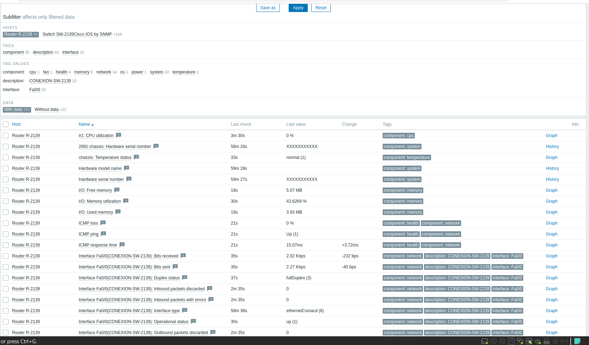
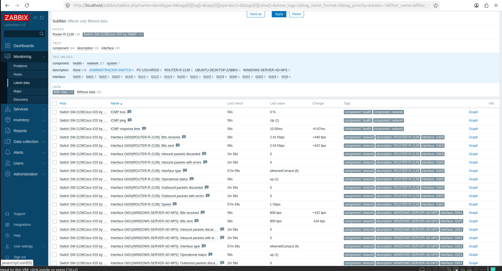

# Monitoreo de R-2139 y SW-2139 en Zabbix

Capturas originales aportadas por el autor después de la revisión del repositorio. Se conservan sin alterar nombres, métricas ni resultados. Aunque la barra lateral del frontend conserva el nombre «Laboratorio A3», la selección de hosts y los datos visibles identifican R-2139 y SW-2139.

## Router R-2139

| Dato visible | Valor en la captura |
|---|---|
| Host | Router R-2139 |
| CPU | 0 % |
| Memoria I/O libre / usada | 5.07 MB / 3.93 MB |
| Utilización de memoria I/O | 43.6269 % |
| ICMP | Up (1), pérdida 0 % |
| Fa0/0, descripción | CONEXION-SW-2139 |
| Tráfico recibido / enviado | 2.02 Kbps / 2.27 Kbps |
| Dúplex / estado | fullDuplex (3) / up (1) |

Las columnas Last check muestran edades relativas de consulta; la captura no contiene una fecha absoluta verificable.

## Switch SW-2139

| Dato visible | Valor en la captura |
|---|---|
| Host | Switch SW-2139Cisco IOS by SNMP |
| ICMP | Up (1), pérdida 0 % |
| Gi0/0, descripción | ROUTER-R-2139 |
| Tráfico recibido / enviado Gi0/0 | 2.41 Kbps / 2.54 Kbps |
| Estado Gi0/0 | up (1) |
| Gi0/1, descripción | WINDOWS-SERVER-AD-NPS |
| Tráfico recibido / enviado Gi0/1 | 800 bps / 800 bps |
| Estado Gi0/1 | up (1) |

El filtro también enumera las descripciones PC-USUARIOS y UBUNTU-DESKTOP-ZABBIX. El ítem de velocidad de Gi0/0 muestra 1 Gbps; la configuración exportada del router indica speed 100 en Fa0/0. Se conserva la diferencia y no se declara resuelta sin nuevas salidas de ambos extremos.

## Alcance

Estas capturas acreditan que Zabbix presenta métricas de los hosts identificados. Los datos de interfaces, CPU y memoria son coherentes con el monitoreo SNMP de Cisco IOS. No muestran las IP configuradas en las interfaces SNMP, la comunidad ni la versión usada; esos parámetros requieren la configuración del host o salidas sanitizadas.

No prueban una violación de port-security, autenticación RADIUS ni rechazo de sondeo desde un origen no autorizado. Esas pruebas se documentan por separado.
