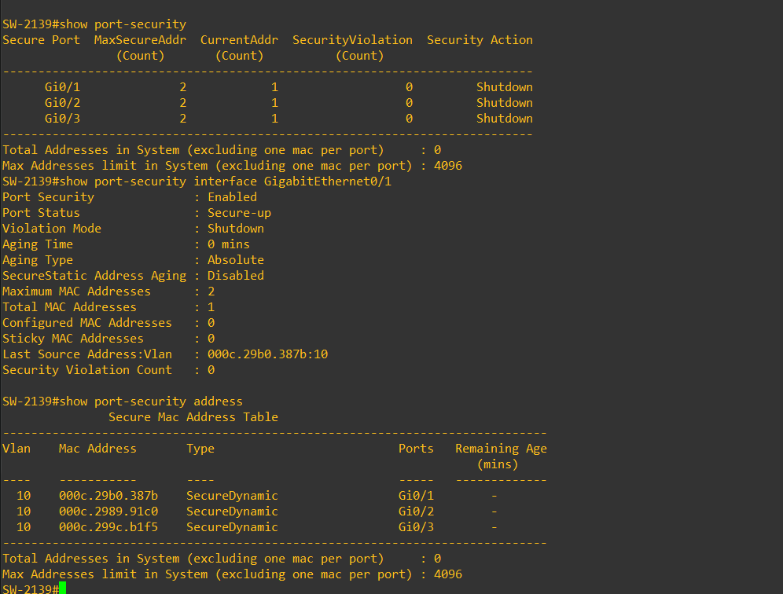

# Evidencias del parcial

- [Router: ARP, DHCP, SSH e interfaces](parcial/router-verificacion.txt): extractos de la salida pegada por el autor. Se omitieron un comando PowerShell introducido por error en IOS y el bloque running-config, disponible sanitizado en configs.
- [Port-security de SW-2139](../imagenes/parcial/port-security.png): adjunto original recuperado de «Topología de red», sin alterar los resultados.

Gi0/1–Gi0/3 muestran máximo 2 MAC, una aprendida por puerto, acción Shutdown y cero violaciones. Gi0/1 está Secure-up. El valor «Shutdown» es la acción configurada, no el estado operativo observado.

## Monitoreo del parcial

- [Router R-2139](../imagenes/parcial/zabbix-R-2139.png): CPU, memoria, ICMP y tráfico de Fa0/0.
- [Switch SW-2139](../imagenes/parcial/zabbix-SW-2139.png): ICMP, tráfico y estado de Gi0/0 y Gi0/1.
- [Descripción y alcance](../docs/ZABBIX.md).

Las capturas AD/NPS y las capturas Zabbix anteriores se conservan como antecedentes separados. Las nuevas imágenes no sustituyen las salidas de autenticación RADIUS o violación de port-security.

## Verificaciones adicionales aportadas

- [Conectividad y DHCP del router](parcial/router-conectividad-dhcp.txt): fragmento textual de la nueva salida, con pings exitosos a .2 y .10 y dos concesiones DHCP. Se omitieron intentos con errores de sintaxis; no se cambian los resultados.
- [Port-security del switch](parcial/port-security-verificacion.txt): transcripción de consultas, contador cero y sin coincidencias en el filtro de logs. No acredita una violación.

La nueva exportación del router sigue mostrando `no aaa new-model`. La respuesta ICMP de .10 no confirma por sí sola que sea el servidor NPS.
